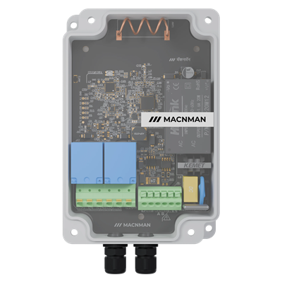

# LoRaWAN Relay Controller - MS-L5-CT-X1

For more detailed information, please visit [Macnman Official Website](https://macnman.com/docs/category/lorawan)

MacSet LoRaWAN relay controller: 2 relay outputs (NO / C / NC), RS485 Modbus RTU master (up to 20 fields) **or** 2 analog inputs (4-20 mA, 0-10 V, digital), 10 relay schedules (regular, cyclic, trigger), powered from 80 - 230 V AC or 12 - 24 V DC, LoRaWAN Class C.

## Codec

|      PLATFORM      | FILE                                                           | FUNCTIONS                     |
| :----------------: | -------------------------------------------------------------- | ----------------------------- |
| The Things Network | [MS_L5_CT_X1_TTN.js](Decoder/MS_L5_CT_X1_TTN.js)               | decodeUplink / encodeDownlink |
|   ChirpStack v4    | [MS_L5_CT_X1_Chirpstack.js](Decoder/MS_L5_CT_X1_Chirpstack.js) | decodeUplink / encodeDownlink |
| Milesight Gateway  | [MS_L5_CT_X1_Milesight.js](Decoder/MS_L5_CT_X1_Milesight.js)   | Decode / Encode               |
|   Downlink only    | [MS_L5_CT_X1_Encoder.js](Encoder/MS_L5_CT_X1_Encoder.js)       | encodeDownlink                |

This is the Macnman LoRaWAN codec V5.1 for controllers and nodes. The output keys are the same as in V5.0, spelling included (`protocall`, `responce`, `SUCCSESS`), so existing dashboards keep working.

Each platform file holds the uplink decoder and the downlink encoder, and all three give the same output. The TTN and Milesight files read floats without `DataView`, so they also run on the gateway's older JavaScript engine. On the Milesight gateway paste the whole file into **both** the decoder box and the encoder box; the JSON for `Encode` may leave out `"port"`, the FPort of the downlink is used. The `Encoder` file is the same downlink encoder on its own, with an example for every FPort (JSON and the bytes it sends).

The device runs in **Class C**: set the network server device profile to Class C too, or downlinks wait for the next uplink.

## FPorts

All multi-byte values are big-endian (MSB first). The device information and the periodic data carry local time (UTC + 5:30), every other uplink carries UTC.

An analog channel in digital mode reports `1` (above 1.8 V) or `0`: in the periodic data as `channel_a_level` / `channel_b_level`, and as the sampling readings (mode `"digital"`). Firmware before 28 Oct 2026 sent the voltage there; the codec still reads its periodic data as `1` / `0`.

| FPORT  | DIRECTION | MESSAGE                                                                                     |
| :----: | :-------: | ------------------------------------------------------------------------------------------- |
|   2    |  uplink   | device information (starts with `00`, once after every join), periodic data (starts with `01`) |
|   3    |  uplink   | sampling readings (`9 + 4 x n` bytes)                                                       |
|   4    |  uplink   | relay event: a regular or trigger schedule switched a relay (43 bytes)                       |
| 5 - 15 |   both    | commands; each is answered on its own FPort, unconfirmed, about 5 s later (none for FPort 7) |
| 17, 18, 19 | both  | ADR, message type, ADR + SF + message type; answered on the same FPort                      |
|   21   |   both    | sampling settings; answered on FPort 21                                                     |

| FPORT | COMMAND                | JSON for the encoder                                                                                                   |
| :---: | ---------------------- | ---------------------------------------------------------------------------------------------------------------------- |
|   5   | relays                 | `{ "port": 5, "relay1": 1, "relay2": 0 }`                                                                              |
|   6   | uplink interval        | `{ "port": 6, "txTime": 3600 }`                                                                                        |
|   7   | relays, no answer      | `{ "port": 7, "relay1": 0, "relay2": 1 }`                                                                              |
|   8   | Modbus coil write      | `{ "port": 8, "slaveId": 1, "numberofreg": 1, "address": 16, "value": 65280 }`                                         |
|   9   | Modbus register write  | `{ "port": 9, "slaveId": 1, "numberofreg": 1, "address": 100, "value": 1500 }`                                         |
|  10   | store a Modbus field   | `{ "port": 10, "Field": 1, "slaveId": 1, "functionCode": 3, "Enable": 1, "dataType": 0, "numberOfParameters": 1, "Registeraddress": 1 }` |
|  11   | relay schedule         | `{ "port": 11, "index": 0, "startTime": 21600, "stopTime": 64800, "dayData": 127, "relayStatus": 0, "alarmType": 1, "enable": 1 }` |
|  12   | RS485 baud / parity    | `{ "port": 12, "baud": 9600, "parity": 0 }`                                                                            |
|  13   | read registers now     | `{ "port": 13, "slaveId": 1, "functionCode": 3, "dataType": 0, "numberOfParameters": 2, "Registeraddress": 1 }`        |
|  14   | read a schedule        | `{ "port": 14, "index": 0 }`                                                                                           |
|  15   | read a Modbus field    | `{ "port": 15, "index": 1 }`                                                                                           |
|  17   | ADR                    | `{ "port": 17, "adr": 1 }`                                                                                             |
|  18   | message type           | `{ "port": 18, "msgtype": 0 }`                                                                                         |
|  19   | ADR + SF + type        | `{ "port": 19, "adr": 0, "sf": 9, "msgtype": 1 }`                                                                      |
|  21   | sampling               | `{ "port": 21, "param": 0, "count": 6, "enable": 1, "interval": 60 }`                                                  |

The `"port"` key must be inside the JSON: ChirpStack v4 does not always pass the FPort to the encoder. Use the same FPort for the downlink itself.

Cyclic schedules add `"onTime"` and `"offTime"` (seconds); trigger schedules (`"alarmType": 3`) add `"threshold"`, `"condition"` (0 above, 1 below, 2 between, then `"min"` and `"max"`) and `"rs485Field"`. Always send the complete schedule, also to switch it off.

The full byte layouts, sizes and examples are in the device documents: *MS-L5-CT-X1 Downlink With port number & Features* and *MS-L5-CT-X1 Features Payload Sizes*.
