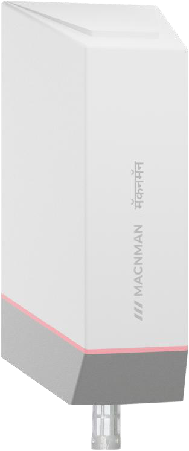

# CO2, Temperature & Humidity Sensor - MY-L1-CO2-X1



For more detailed information, please visit [Macnman Official Website](https://macnman.com/docs/category/lorawan)

## Codec

|      PLATFORM      | UPLINK ONLY                                                                       | UPLINK + DOWNLINK                                                                 | FUNCTIONS                                      |
| :----------------: | --------------------------------------------------------------------------------- | --------------------------------------------------------------------------------- | ---------------------------------------------- |
| The Things Network | [MY-L1-CO2-X1_decoder_ttn.js](Decoders/MY-L1-CO2-X1_decoder_ttn.js)               | [MY-L1-CO2-X1_encoder_ttn.js](Encoders/MY-L1-CO2-X1_encoder_ttn.js)               | decodeUplink / encodeDownlink / decodeDownlink |
|   ChirpStack v4    | [MY-L1-CO2-X1_decoder_chirpstack.js](Decoders/MY-L1-CO2-X1_decoder_chirpstack.js) | [MY-L1-CO2-X1_encoder_chirpstack.js](Encoders/MY-L1-CO2-X1_encoder_chirpstack.js) | decodeUplink / encodeDownlink / decodeDownlink |
| Milesight Gateway  | [MY-L1-CO2-X1_decoder_milesight.js](Decoders/MY-L1-CO2-X1_decoder_milesight.js)   | [MY-L1-CO2-X1_encoder_milesight.js](Encoders/MY-L1-CO2-X1_encoder_milesight.js)   | Decode / Encode                                |

The files in `Decoders/` decode uplinks only (`decodeUplink`, Milesight `Decode`). They have no downlink encoder, so a downlink sent as JSON cannot be encoded with them; raw HEX downlinks still go out.

The files in `Encoders/` hold the uplink decoder and the downlink encoder: use them to send downlinks. Both decode uplinks to exactly the same JSON.

Where to paste:

- **The Things Network**: *Payload formatters → Custom Javascript formatter*. The decoder file goes into the *Uplink* formatter, the encoder file into both the *Uplink* and the *Downlink* formatter.
- **ChirpStack v4**: *Device profile → Codec → JavaScript functions*, the whole file.
- **Milesight Gateway**: *Network Server → Profiles → device profile → Payload Codec → Custom*. The decoder file goes into the decoder box, the encoder file into both the decoder box and the encoder box.

## Payload

```
+-------------------------------------------------------------+
|              DEVICE UPLINK / DOWNLINK PAYLOAD               |
+-------------+-----------------------------------------------+
|    FPORT    |                    PAYLOAD                    |
+-------------+-------------------------+---------+-----------+
| frame type  |          DATA           | BATTERY |    UTC    |
|             |         N Bytes         | 1 Byte  |  4 Bytes  |
+-------------+-------------------------+---------+-----------+
```

The FPort tells the frame type. All multi-byte values are big-endian (MSB first). Most uplinks end with the battery level and the UTC time; downlinks carry the DATA only.

### Attribute

|   CHANNEL   |    FPORT    | LENGTH | DESCRIPTION                                                                                                                                                                                                                                                                                       |
| :---------: | :---------: | :----: | ------------------------------------------------------------------------------------------------------------------------------------------------------------------------------------------------------------------------------------------------------------------------------------------------- |
| Device Info |    0x05     |   11   | firmware_version(3B) + hardware_version(3B) + utc(4B) + sensors(1B)<br/>firmware_version, e.g. 010000 -> v1.0.0<br/>hardware_version, e.g. 010000 -> v1.0.0<br/>sensors: bit 0 (1: CO2 sensor found), bits 1 - 2 temperature & humidity sensor (0: not found, 1: on the CO2 sensor, 2: separate)<br/>sent once after every join; the time in this frame may not be synced yet |
| Config ACK  | 0x10 - 0x17 | 2 - 10 | setting(N bytes) + battery(1B)<br/>sent about 5 s after a downlink is applied, on the same FPort, with the setting now stored (same bytes as the [Downlink](#downlink) command)<br/>0x16: always co2interval(2B) + pressure(2B)<br/>0x17: target(2B) + correction(2B, int16, ppm) + status(1B, 0: done, 1: failed), about 40 s after the command |

### Telemetry

|  CHANNEL  | FPORT |     LENGTH      | DESCRIPTION                                                                                                                                                                                                                                                                                                                     |
| :-------: | :---: | :-------------: | ------------------------------------------------------------------------------------------------------------------------------------------------------------------------------------------------------------------------------------------------------------------------------------------------------------------------------- |
| Heartbeat | 0x02  |       11        | temperature(2B) + humidity(2B) + co2(2B) + battery(1B) + utc(4B)<br/>temperature, unit: °C, int16 / 100<br/>humidity, unit: %RH, uint16 / 100<br/>co2, unit: ppm, uint16<br/>battery, unit: %, bits 0 - 6; bit 7 = 1 while the CO2 sensor warms up (co2Warmup)<br/>utc, unit: s (Unix time, UTC)<br/>also sent once after start-up and at every Ping |
| Sampling  | 0x03  | 7 + 2n / 7 + 6n | count(1B) + param(1B) + sample × n + battery(1B) + utc(4B)<br/>count, range: 2 - 12 (2 - 6 with all)<br/>param, values: (0: temperature, 1: humidity, 2: co2, 3: all)<br/>sample: one value (2B), or temperature + humidity + co2 (6B) with all, oldest first                                                                  |
|  Trigger  | 0x04  |       14        | trig(1B) + param(1B) + event(1B) + value(2B) + min(2B) + max(2B) + battery(1B) + utc(4B)<br/>trig, values: (1, 2)<br/>param, values: (0: temperature, 1: humidity, 2: co2)<br/>event, values: (0: CLEAR, 1: ALARM)<br/>value, min, max: in the param's format (temperature int16 / 100, humidity uint16 / 100, co2 uint16)        |

A value the sensor could not read is sent as 0x8000 (temperature) or 0xFFFF (humidity, CO2) and decoded as `"error"`.

## Downlink

Put the FPort in the JSON as `"port"` and send the downlink on the same FPort. Downlinks need an encoder file. In the JSON, `param` can also be a name: `"temperature"`, `"humidity"`, `"co2"` (and `"all"` for sampling).

|      CHANNEL       |   FPORT   | LENGTH | DESCRIPTION                                                                                                                                                                                                                                                                                                                    |
| :----------------: | :-------: | :----: | ------------------------------------------------------------------------------------------------------------------------------------------------------------------------------------------------------------------------------------------------------------------------------------------------------------------------------ |
| Reporting Interval | 0x10 (16) |   4    | interval(4B)<br/>interval, unit: s, range: 60 - 86400                                                                                                                                                                                                                                                                          |
|        ADR         | 0x11 (17) |   1    | adr(1B)<br/>adr, values: (0: off, 1: on)<br/>the device restarts to apply                                                                                                                                                                                                                                                      |
|    Message Type    | 0x12 (18) |   1    | msgtype(1B)<br/>msgtype, values: (0: unconfirmed, 1: confirmed)                                                                                                                                                                                                                                                                |
|    Message Info    | 0x13 (19) |   3    | adr(1B) + sf(1B) + msgtype(1B)<br/>sf, range: 7 - 12, used when ADR is off (DR = 12 - SF)<br/>the device restarts to apply                                                                                                                                                                                                      |
|      Trigger       | 0x14 (20) |   9    | trig(1B) + param(1B) + min(2B) + max(2B) + checktime(2B) + enable(1B)<br/>trig, values: (1, 2)<br/>param, values: (0: temperature, 1: humidity, 2: co2)<br/>min, max: in the param's format (temperature int16 × 100, humidity uint16 × 100, co2 uint16 ppm), limited to -30 - 80 °C, 0 - 100 %RH, 0 - 32000 ppm<br/>checktime, unit: s, range: 5 - 65535<br/>enable, values: (0: off, 1: on) |
|      Sampling      | 0x15 (21) |   3    | param(1B) + count(1B) + enable(1B)<br/>param, values: (0: temperature, 1: humidity, 2: co2, 3: all)<br/>count, range: 2 - 12 (2 - 6 with all)<br/>enable, values: (0: off, 1: on)                                                                                                                                             |
|     CO2 Config     | 0x16 (22) | 2 / 4  | co2interval(2B) + pressure(2B, optional)<br/>co2interval, unit: s, range: 10 - 600 (time between CO2 readings)<br/>pressure, unit: hPa, range: 700 - 1100, 0: compensation off; leave it out to keep the stored value                                                                                                        |
| CO2 Recalibration  | 0x17 (23) |   2    | target(2B)<br/>target, unit: ppm, range: 300 - 32000<br/>only in stable air of known CO2; the reply comes about 40 s later                                                                                                                                                                                                     |

## Example

### Uplink

```json
// FPort 2: 0AEB 1740 03B0 63 6ADAEE12
{
    "type": "heartbeat",
    "deviceInfo": {
        "fPort": 2,
        "battery": 99,
        "unixUTC": 1792732690,
        "timeUTC": "2026-10-23T05:18:10Z",
        "timeIST": "2026-10-23T10:48:10+05:30"
    },
    "sensorInfo": { "temperature": 27.95, "humidity": 59.52, "co2": 944, "co2Warmup": false }
}

// FPort 2: 8000 FFFF FFFF E3 6ADAEE12   (sensor not read; CO2 sensor still warming up)
{
    "type": "heartbeat",
    "deviceInfo": {
        "fPort": 2,
        "battery": 99,
        "unixUTC": 1792732690,
        "timeUTC": "2026-10-23T05:18:10Z",
        "timeIST": "2026-10-23T10:48:10+05:30"
    },
    "sensorInfo": { "temperature": "error", "humidity": "error", "co2": "error", "co2Warmup": true }
}

// FPort 3: 02 03 0929119E0264 093811B20280 61 6ADAEE12
{
    "type": "sampling",
    "deviceInfo": {
        "fPort": 3,
        "battery": 97,
        "unixUTC": 1792732690,
        "timeUTC": "2026-10-23T05:18:10Z",
        "timeIST": "2026-10-23T10:48:10+05:30"
    },
    "sensorInfo": {
        "param": "all",
        "count": 2,
        "samples": [
            { "temperature": 23.45, "humidity": 45.1, "co2": 612 },
            { "temperature": 23.6, "humidity": 45.3, "co2": 640 }
        ]
    }
}

// FPort 4: 01 02 01 04E2 0000 03E8 5F 6ADAEE12
{
    "type": "trigger",
    "deviceInfo": {
        "fPort": 4,
        "battery": 95,
        "unixUTC": 1792732690,
        "timeUTC": "2026-10-23T05:18:10Z",
        "timeIST": "2026-10-23T10:48:10+05:30",
        "trigNum": 1,
        "event": "ALARM"
    },
    "sensorInfo": { "param": "co2", "unit": "ppm", "value": 1250, "min": 0, "max": 1000 }
}

// FPort 5: 010000 010000 0000000C 03   (clock not synced yet: 12 s after start-up)
{
    "type": "boot",
    "deviceInfo": {
        "fPort": 5,
        "unixUTC": 12,
        "timeUTC": "1970-01-01T00:00:12Z",
        "timeIST": "1970-01-01T05:30:12+05:30",
        "Firmware Version": "1.0.0",
        "Hardware Version": "1.0.0",
        "CO2 Sensor": "STCC4",
        "TH Sensor": "SHT4x on STCC4"
    }
}

// FPort 16: 00000258 61
{
    "type": "config_ack",
    "configAck": {
        "appliedPort": 16,
        "feature": "tx_interval",
        "interval": 600,
        "battery": 97
    }
}

// FPort 22: 003C 03F5 61
{
    "type": "config_ack",
    "configAck": {
        "appliedPort": 22,
        "feature": "co2_config",
        "co2interval": 60,
        "pressure": 1013,
        "battery": 97
    }
}

// FPort 23: 01A4 FFEC 00 61
{
    "type": "config_ack",
    "configAck": {
        "appliedPort": 23,
        "feature": "co2_frc",
        "target": 420,
        "correction": -20,
        "status": "OK",
        "battery": 97
    }
}
```

The Milesight files return the same object without the `{ data }` wrapper.

### Downlink

```json
// FPort 16: 00000258
{ "port": 16, "interval": 600 }

// FPort 17: 01
{ "port": 17, "adr": 1 }

// FPort 18: 01
{ "port": 18, "msgtype": 1 }

// FPort 19: 000901
{ "port": 19, "adr": 0, "sf": 9, "msgtype": 1 }

// FPort 20: 0102000003E8003C01
{ "port": 20, "trig": 1, "param": "co2", "min": 0, "max": 1000, "checktime": 60, "enable": 1 }

// FPort 20: 0200FC180DAC038401
{ "port": 20, "trig": 2, "param": "temperature", "min": -10.00, "max": 35.00, "checktime": 900, "enable": 1 }

// FPort 21: 030601
{ "port": 21, "param": "all", "count": 6, "enable": 1 }

// FPort 22: 00780384
{ "port": 22, "co2interval": 120, "pressure": 900 }

// FPort 22: 0078   (pressure setting unchanged)
{ "port": 22, "co2interval": 120 }

// FPort 23: 01A4   (only in stable air of known CO2)
{ "port": 23, "target": 420 }
```
