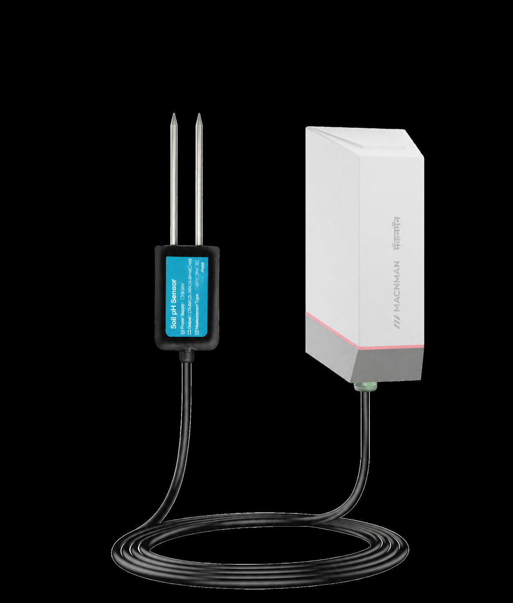

# Soil pH Sensor - MY-L1-SPH-X1



For more detailed information, please visit [Macnman Official Website](https://macnman.com/docs/category/lorawan)

## Codec

|      PLATFORM      | UPLINK ONLY                                                                         | UPLINK + DOWNLINK                                                                   | FUNCTIONS                                          |
| :----------------: | ----------------------------------------------------------------------------------- | ----------------------------------------------------------------------------------- | -------------------------------------------------- |
| The Things Network | [MY-L1-SPH-X1_decoder_ttn.js](Decoders/MY-L1-SPH-X1_decoder_ttn.js)                 | [MY-L1-SPH-X1_encoder_ttn.js](Encoders/MY-L1-SPH-X1_encoder_ttn.js)                 | decodeUplink / encodeDownlink                      |
|   ChirpStack v4    | [MY-L1-SPH-X1_decoder_chirpstack.js](Decoders/MY-L1-SPH-X1_decoder_chirpstack.js)   | [MY-L1-SPH-X1_encoder_chirpstack.js](Encoders/MY-L1-SPH-X1_encoder_chirpstack.js)   | decodeUplink / encodeDownlink (v3: Decode / Encode) |
| Milesight Gateway  | [MY-L1-SPH-X1_decoder_milesight.js](Decoders/MY-L1-SPH-X1_decoder_milesight.js)     | [MY-L1-SPH-X1_encoder_milesight.js](Encoders/MY-L1-SPH-X1_encoder_milesight.js)     | Decode / Encode                                    |

The files in `Decoders/` decode uplinks only. They have no downlink encoder, so a downlink sent as JSON cannot be encoded with them.

The files in `Encoders/` hold the uplink decoder and the downlink encoder: use them to send downlinks. Both decode uplinks to exactly the same JSON.

## Payload

```
+-------------------------------------------------------------+
|              DEVICE UPLINK / DOWNLINK PAYLOAD               |
+-------------+-----------------------------------------------+
|    FPORT    |                    PAYLOAD                    |
+-------------+-------------------------+---------+-----------+
| frame type  |          DATA           | BATTERY |    UTC    |
|             |         N Bytes         | 1 Byte  |  4 Bytes  |
+-------------+-------------------------+---------+-----------+
```

The FPort tells the frame type. All multi-byte values are big-endian (MSB first). Most uplinks end with the battery level and the UTC time; downlinks carry the DATA only. The battery level is counted by the firmware from measured currents and on-times (the board has no battery voltage input).

### Attribute

|   CHANNEL   |    FPORT    | LENGTH | DESCRIPTION                                                                                                                                                                                                                                                                                       |
| :---------: | :---------: | :----: | ------------------------------------------------------------------------------------------------------------------------------------------------------------------------------------------------------------------------------------------------------------------------------------------------- |
| Device Info |    0x05     |   10   | firmware_version(3B) + hardware_version(3B) + utc(4B)<br/>firmware_version, e.g. 010000 -> V1.0<br/>hardware_version, e.g. 010000 -> V1.0<br/>sent once after every join; the time in this frame may not be synced yet                                                                         |
| Config ACK  | 0x10 - 0x16 | 2 - 11 | setting(N bytes) + battery(1B)<br/>sent on the same FPort as the downlink, with the setting now stored (same bytes as the [Downlink](#downlink) command)<br/>FPort 20 adds source(1B) before the battery<br/>FPort 21 adds source(1B) + interval(2B) before the battery<br/>FPort 22 always carries all 7 setting bytes<br/>source = 0x00 (RS485) |

### Telemetry

|  CHANNEL  | FPORT | LENGTH | DESCRIPTION                                                                                                                                                                                                                                                                                                                   |
| :-------: | :---: | :----: | ----------------------------------------------------------------------------------------------------------------------------------------------------------------------------------------------------------------------------------------------------------------------------------------------------------------------------- |
| Heartbeat | 0x02  | 10 / 8 | type(1B) + source(1B) + tag(1B) + ph(2B) + battery(1B) + utc(4B)<br/>type = 0x01, source = 0x00 (RS485)<br/>tag, values: (0x21: one value follows, 0xE0: the probe read failed, no ph bytes)<br/>ph, uint16 / 100, unit: pH, range: 0 - 14 (the probe measures 3 - 9)<br/>battery, unit: %<br/>utc, unit: s (Unix time, UTC) |
| Sampling  | 0x03  | 9 + 2n | count(1B) + source(1B) + field(1B) + type(1B) + samples(2B × n) + battery(1B) + utc(4B)<br/>count, range: 2 - 12<br/>source = 0x00 (RS485), field = 0x01 (pH), type = 0x01 (uint16)<br/>samples: n × uint16 / 100, unit: pH, oldest first; 0xFFFF = that read failed                                                     |
|  Trigger  | 0x04  |   15   | trig(1B) + param(1B) + event(1B) + value(2B) + min(2B) + max(2B) + battery(1B) + utc(4B) + source(1B)<br/>trig, values: (1, 2)<br/>param = 0x00 (pH)<br/>event, values: (0: CLEAR, 1: ALARM)<br/>value, min, max: int16 / 100, unit: pH<br/>source = 0x00 (RS485)                                                          |

### RS485 Reply

Sent straight after a baud rate downlink, on the same FPort.

|     CHANNEL     |   FPORT   | LENGTH | DESCRIPTION                                                                                                                                                                                       |
| :-------------: | :-------: | :----: | ------------------------------------------------------------------------------------------------------------------------------------------------------------------------------------------------- |
| Baud Rate Reply | 0x0C (12) |   11   | header(4B) + baud(2B) + parity(1B) + utc(4B)<br/>header = 0x02 + 0x02 + 0x0C + state(1B)<br/>state, values: (0: ok, 1: baud refused)<br/>parity: as requested (0: none, 1: even, 2: odd, 0xFF: left unchanged) |

## Downlink

Use a file from `Encoders/`. Put the FPort in the JSON as `"port"` and send the downlink on the same FPort. Every setting is echoed back on its FPort ([Config ACK](#attribute)); FPort 12 answers with the [Baud Rate Reply](#rs485-reply). A missing or out-of-range value is refused by the encoder with an error, before anything is sent.

### Setting

|      CHANNEL       |   FPORT   | LENGTH | DESCRIPTION                                                                                                                                                                                                                            |
| :----------------: | :-------: | :----: | -------------------------------------------------------------------------------------------------------------------------------------------------------------------------------------------------------------------------------------- |
| Reporting Interval | 0x10 (16) |   4    | interval(4B)<br/>interval, unit: s, range: 60 - 86400                                                                                                                                                                                   |
|        ADR         | 0x11 (17) |   1    | adr(1B)<br/>adr, values: (0: off, 1: on)<br/>the device restarts to apply                                                                                                                                                              |
|    Message Type    | 0x12 (18) |   1    | msgtype(1B)<br/>msgtype, values: (0: unconfirmed, 1: confirmed)                                                                                                                                                                        |
|    Message Info    | 0x13 (19) |   3    | adr(1B) + sf(1B) + msgtype(1B)<br/>sf, range: 7 - 12, used when ADR is off (DR = 12 - SF)<br/>the device restarts to apply                                                                                                              |
|      Trigger       | 0x14 (20) |   9    | trig(1B) + param(1B) + min(2B) + max(2B) + checktime(2B) + enable(1B)<br/>trig, values: (1, 2)<br/>param = 0x00 (pH)<br/>min, max: int16, pH × 100, range: 0 - 14, min ≤ max<br/>checktime, unit: s, range: 30 - 65535<br/>enable, values: (0: off, 1: on) |
|      Sampling      | 0x15 (21) | 3 / 5  | param(1B) + count(1B) + enable(1B) + interval(2B, optional)<br/>param = 0x00 (pH)<br/>count, range: 2 - 12<br/>enable, values: (0: off, 1: on)<br/>interval, unit: s, range: 30 - 3600                                                     |

### Sensor

|  CHANNEL  |   FPORT   |   LENGTH   | DESCRIPTION                                                                                                                                                                                                                                                                                                                                                                  |
| :-------: | :-------: | :--------: | ---------------------------------------------------------------------------------------------------------------------------------------------------------------------------------------------------------------------------------------------------------------------------------------------------------------------------------------------------------------------------- |
| pH Probe  | 0x16 (22) | 4 / 6 / 7  | slaveId(1B) + fc(1B) + register(2B) + offset(2B, optional) + divisor(1B, optional)<br/>slaveId, range: 1 - 247 (0: keep)<br/>fc, values: (3, 4) (0: keep)<br/>register: the probe's register address as sent on the bus, JXCT: 0x0006 (0xFFFF: keep)<br/>offset: int16, pH × 100, range: -2.00 - 2.00, added to every reading (calibration)<br/>divisor, values: (1, 10, 100), register counts per pH; needs the offset in the same downlink |
| Baud Rate | 0x0C (12) |     3      | baud(2B) + parity(1B)<br/>baud, range: 1200 - 57600 (115200 can be set only in the app)<br/>parity, values: (0: none, 1: even, 2: odd, 0xFF: keep)                                                                                                                                                                                                                         |
|   Class   | 0x03 (3)  |     1      | class(1B)<br/>class = 0x00 (class A)<br/>the encoders refuse class B (not built into the firmware) and class C (on this battery node the receiver would stay on, ~137 mAh a day)                                                                                                                                                                                   |

## Example

### Uplink

```json
// FPort 2: 01 00 21 02AD 62 6ABCDDA0
{
    "type": "heartbeat",
    "deviceInfo": {
        "fPort": 2,
        "source": "rs485",
        "battery": 98,
        "unixUTC": 1790762400,
        "timeUTC": "2026-09-30T10:00:00Z",
        "timeIST": "2026-09-30T15:30:00+05:30"
    },
    "sensorInfo": {
        "ph": 6.85,
        "status": "ok"
    }
}

// FPort 2: 01 00 E0 62 6ABCDDA0   (the probe did not answer)
{
    "type": "heartbeat",
    "deviceInfo": {
        "fPort": 2,
        "source": "rs485",
        "battery": 98,
        "unixUTC": 1790762400,
        "timeUTC": "2026-09-30T10:00:00Z",
        "timeIST": "2026-09-30T15:30:00+05:30"
    },
    "sensorInfo": {
        "ph": null,
        "status": "read_error"
    }
}

// FPort 3: 03 00 01 01 02AD FFFF 0226 62 6ABCDDA0   (second sample failed)
{
    "type": "sampling",
    "deviceInfo": {
        "fPort": 3,
        "source": "rs485",
        "battery": 98,
        "unixUTC": 1790762400,
        "timeUTC": "2026-09-30T10:00:00Z",
        "timeIST": "2026-09-30T15:30:00+05:30"
    },
    "sensorInfo": {
        "param": "pH",
        "count": 3,
        "samples": [6.85, null, 5.5]
    }
}

// FPort 4: 01 00 01 0226 012C 0384 5A 6ABCDDA0 00
{
    "type": "trigger",
    "deviceInfo": {
        "fPort": 4,
        "source": "rs485",
        "battery": 90,
        "unixUTC": 1790762400,
        "timeUTC": "2026-09-30T10:00:00Z",
        "timeIST": "2026-09-30T15:30:00+05:30",
        "trigNum": 1,
        "event": "ALARM"
    },
    "sensorInfo": {
        "param": "pH",
        "value": 5.5,
        "min": 3,
        "max": 9
    }
}

// FPort 5: 010000 010000 00000000   (clock not synced yet)
{
    "type": "boot",
    "deviceInfo": {
        "fPort": 5,
        "unixUTC": 0,
        "timeUTC": "not synced",
        "timeIST": "not synced",
        "Firmware Version": "V1.0",
        "Hardware Version": "V1.0"
    }
}

// FPort 20: 01 00 0226 02EE 0258 01 00 5A
{
    "type": "config_ack",
    "configAck": {
        "appliedPort": 20,
        "feature": "trigger",
        "trig": 1,
        "param": "pH",
        "source": "rs485",
        "min": 5.5,
        "max": 7.5,
        "checktime": 600,
        "enable": "ENABLED",
        "battery": 90
    }
}

// FPort 22: 01 03 0006 FFF1 64 5A
{
    "type": "config_ack",
    "configAck": {
        "appliedPort": 22,
        "feature": "ph_config",
        "slaveId": 1,
        "fc": 3,
        "register": 6,
        "offset": -0.15,
        "divisor": 100,
        "battery": 90
    }
}

// FPort 12: 02 02 0C 00 2580 00 6ABCDDA0
{
    "type": "modbus_ack",
    "deviceInfo": {
        "fPort": 12,
        "unixUTC": 1790762400,
        "timeUTC": "2026-09-30T10:00:00Z",
        "timeIST": "2026-09-30T15:30:00+05:30"
    },
    "modbusAck": {
        "state": 0,
        "state_text": "ok",
        "feature": "baud",
        "baud": 9600,
        "parity": 0,
        "parity_text": "none"
    }
}
```

### Downlink

```json
// FPort 16: 00000708
{ "port": 16, "interval": 1800 }

// FPort 17: 01
{ "port": 17, "adr": 1 }

// FPort 18: 01
{ "port": 18, "msgtype": 1 }

// FPort 19: 000901
{ "port": 19, "adr": 0, "sf": 9, "msgtype": 1 }

// FPort 20: 0100022602EE025801
{ "port": 20, "trig": 1, "param": 0, "min": 5.5, "max": 7.5, "checktime": 600, "enable": 1 }

// FPort 21: 000601012C
{ "port": 21, "param": 0, "count": 6, "enable": 1, "interval": 300 }

// FPort 22: 01030006FFF164
{ "port": 22, "slaveId": 1, "fc": 3, "register": 6, "offset": -0.15, "divisor": 100 }

// FPort 22: 0000FFFF0014
{ "port": 22, "offset": 0.2 }

// FPort 12: 258000
{ "port": 12, "baud": 9600, "parity": 0 }

// FPort 3: 00
{ "port": 3, "class": "A" }
```
